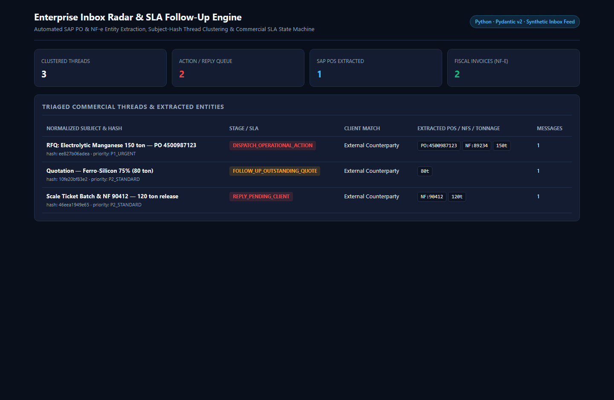
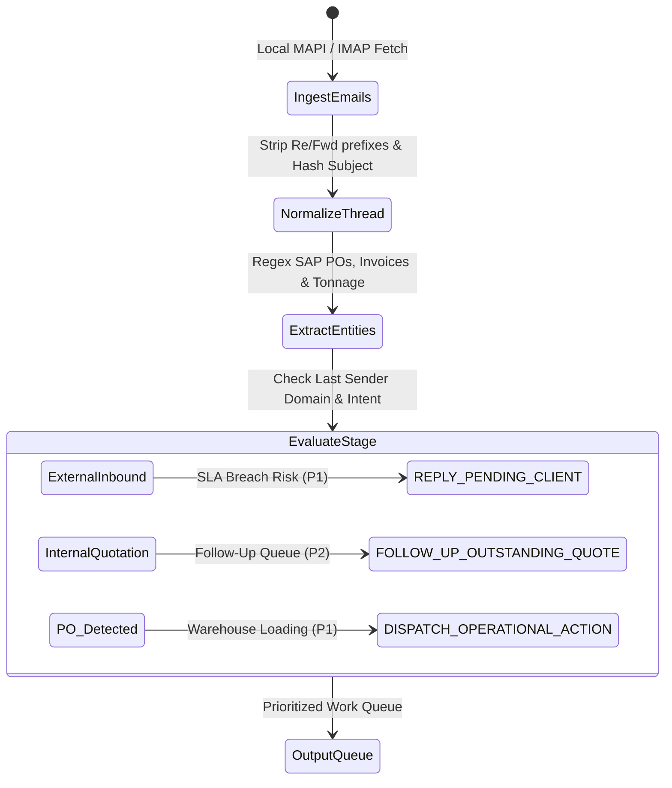

# 📬 Enterprise Inbox Radar & SLA Follow-Up Engine

[](LICENSE)
[](https://www.python.org/)
[](https://docs.pydantic.dev/)

An automated corporate inbox triage, thread clustering, entity extraction, and SLA follow-up radar engine. Designed to organize messy B2B email traffic into prioritized, actionable operational work queues without leaking confidential data to cloud LLMs.

---

## 🖥️ Interactive Visual Demo (1-Command Launch)



Launch the interactive inbox triage, SAP PO/NF-e entity extraction, and SLA state machine dashboard preloaded with **100% synthetic commercial threads**:

```bash
git clone https://github.com/Wenderson-Werneck/enterprise-inbox-radar.git
cd enterprise-inbox-radar
pip install -r requirements.txt
python demo_app.py
# Open http://127.0.0.1:8005
```

---

## 🏗 System Architecture & Workflow



---

## 🎯 Action Stages & Business Rules

1. **`REPLY_PENDING_CLIENT` (P1/P2)**:
   The latest email in the thread arrived from an external client or supplier and awaits internal response.
2. **`FOLLOW_UP_OUTSTANDING_QUOTE` (P2)**:
   The latest email was sent by the internal sales/procurement team with a commercial quotation. Triggers automated reminders after $T+48h$ without client feedback.
3. **`DISPATCH_OPERATIONAL_ACTION` (P1 Urgent)**:
   A formal Purchase Order (`PO \d{5,10}`) or billing invoice was identified in the thread. Directs tickets to logistics and warehouse execution teams.

---

## 🚀 Quick Start

### Installation

```bash
git clone https://github.com/Wenderson-Werneck/enterprise-inbox-radar.git
cd enterprise-inbox-radar
pip install -r requirements.txt
```

### Running Test Suite

```bash
pytest -v
```

### Example Usage

```python
from src.engine import InboxRadarEngine
from src.models import RawEmail

engine = InboxRadarEngine(internal_domain="enterprise.com")

emails = [
    RawEmail(
        message_id="msg_01",
        sender_email="buyer@nordicalloys.com",
        sender_name="Lars Olsen",
        recipient_emails=["sales@enterprise.com"],
        subject="PO 4500123456 - Delivery for Friday",
        body_text="Please proceed with shipment of 100 MT of ferro-alloys as per PO 4500123456.",
        received_timestamp="2026-11-09T10:00:00Z",
    )
]

triaged = engine.process_mailbox(emails)
for t in triaged:
    print(f"[{t.priority}] {t.stage} -> POs: {t.entities.purchase_orders}")
```

---

## 🔒 Privacy & Defense-in-Depth

- Operates 100% locally on corporate premises or encrypted local SQLite/PostgreSQL databases.
- Zero external API transmission of commercial correspondence.
- Sanitized test fixtures using synthetic enterprise identities.

## 📄 License

MIT © [Wenderson Werneck](https://github.com/Wenderson-Werneck)
